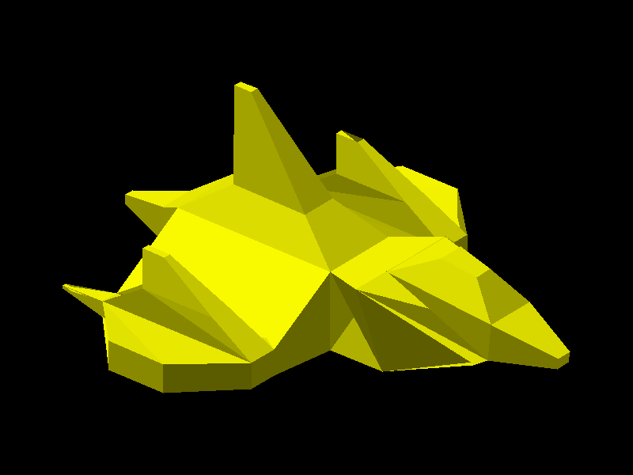

# Proyecto 1 - Ejercicio 1: Render de modelo OBJ

Software renderer en C++ con SDL2 que carga el modelo `NaveEspacial.obj`
(hecho en Blender en el laboratorio anterior) y lo dibuja usando una función
propia para rellenar triángulos.



## Cómo funciona

1. `loadOBJ` ([src/obj_loader.cpp](src/obj_loader.cpp)) lee las líneas `v`
   (vértices) y `f` (caras) del archivo, guardando los índices en base 0.
2. `render` ([src/main.cpp](src/main.cpp)) recorre manualmente cada cara, toma
   los índices de sus vértices y con ellos obtiene los tres vértices de cada
   triángulo. Las caras de 4 vértices se dividen en dos triángulos
   (`0,1,2` y `0,2,3`).
3. Cada vértice se rota (40° alrededor del eje vertical y 30° de inclinación)
   para ver la nave en diagonal, y luego se proyecta de forma ortográfica a la
   pantalla, centrado y escalado para ocupar el 80% de la ventana.
4. Cada triángulo se sombrea según el ángulo entre su normal y una luz, y se
   dibujan del más lejano al más cercano (algoritmo del pintor) para que las
   caras de enfrente queden encima.
5. `triangle` ([src/triangle.cpp](src/triangle.cpp)) rellena el triángulo en el
   framebuffer usando funciones de arista sobre su caja envolvente.

El modelo tiene 136 vértices y 132 caras, que resultan en 264 triángulos.

## Compilar y ejecutar

Requiere CMake, un compilador C++17 y SDL2 (por ejemplo con MSYS2 UCRT64:
`pacman -S mingw-w64-ucrt-x86_64-SDL2`).

```sh
cmake -S . -B build -G Ninja
cmake --build build
cd build
./render_obj            # abre la ventana
./render_obj --screenshot   # guarda render.bmp y termina
```

Dentro de la ventana: `P` guarda una captura en `render.bmp`, `Esc` cierra.
